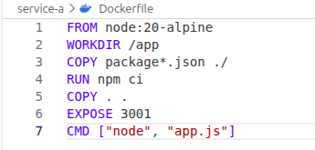
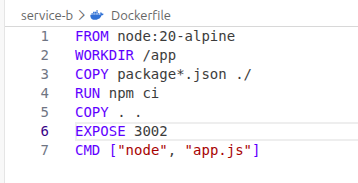
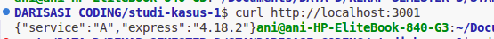

# Studi Kasus 1 — Dependency Hell

**Disusun oleh:** ⟦Ani Rizqi Ziarotus S./ E41251131⟧
**Tanggal:** ⟦2026-11-22⟧
**Repo:** ⟦URL GitHub⟧

---

## 1. Deskripsi Konflik

### 1.1 Kebutuhan versi per service

| Service | Library | Versi | Alasan |
| :--- | :--- | :--- | :--- |
| Service A | `express` | `4.18.2` | Kode memakai sintaks route v4 (string literal), sudah stabil di produksi |
| Service B | `express` | `5.1.0` | Kode memakai sintaks route v5 (`'/*splat'`), fitur baru yang dibutuhkan tim B |

**Bukti versi terpasang** (`npm ls express` di tiap folder):

```text
# service-a
service-a@1.0.0 /home/ani/Documents/DATA D/REKAP SEMSTER 3/STANDARISASI CODING/studi-kasus-1/service-a
└── express@4.18.2

# service-b
service-b@1.0.0 /home/ani/Documents/DATA D/REKAP SEMSTER 3/STANDARISASI CODING/studi-kasus-1/service-b
└── express@5.1.0

### 1.2 Konflik
express@5 mengandung breaking change pada sintaks routing (mis. wildcard '*' di v4 berubah menjadi '/*splat' di v5). Dalam satu proses Node, modul express hanya bisa di-resolve ke satu versi mayor lewat node_modules. Jika dipaksa satu versi:

Pakai v4 → route di Service B gagal/error.

Pakai v5 → route di Service A gagal/error.

## 2. Strategi Terpilih: Isolasi Container

### 2.1 Keputusan
Setiap service di-build dan dijalankan sebagai container Docker terpisah. Masing-masing memiliki filesystem, node_modules, dan runtime Node sendiri.

### 2.2 Alasan
1. Isolasi total — node_modules Service A dan B tidak saling bertabrakan; masing-masing container memuat versi express yang dibutuhkan.

2. Memenuhi syarat "satu server" — dua container dapat berjalan di satu host (VM/bare metal), dengan port berbeda (3001 & 3002) atau di belakang reverse proxy (nginx/traefik).

3. Reproducible — Dockerfile memakai npm ci dan lockfile ter-commit, sehingga image identik di laptop maupun CI.

4. Tidak ada perubahan kode — Service A dan B tetap memakai kode & versi dependensi aslinya; tidak perlu downgrade/upgrade paksa.

5. Skalabel — kelak jika A butuh express@5 juga (atau B pindah ke framework lain), tidak ada ripple effect.

### 2.3 Trade-off utama
- Konsumsi resource: dua image Node (~50–60 MB tiap image alpine) vs satu proses Node tunggal.

- Kompleksitas operasional: perlu orkestrasi (docker compose, atau minimal script docker run).

- Observability: log tersebar di dua container; perlu agregasi (mis. docker logs, Loki, dsb).

Trade-off ini dapat diterima untuk skenario dua service produksi dengan kebutuhan versi mayor berbeda.


## 3 Tabel Perbandingan Strategi

Strategi	Kelebihan	Kekurangan	Kapan Dipakai
Isolasi container	Isolasi penuh (filesystem & node_modules terpisah); reproducible lewat Dockerfile + lockfile; tidak mengubah kode; skala independen per service	Overhead resource (CPU/RAM/image); butuh orkestrasi & observability tambahan; butuh Docker terpasang di host	Rekomendasi utama — dua service produksi dengan versi mayor berbeda; lingkungan yang sudah memakai Docker/Kubernetes
npm workspaces (monorepo)	Satu repo & satu package.json root; dependency sharing (paket umum ter-hoist); satu pipeline CI	Mengandalkan perilaku hoisting — konflik versi mayor bisa tak terduga; coupling build antar-paket; disk & waktu install lebih besar; tidak mengisolasi runtime	Tim kecil yang ingin satu repo, versi mayor masih bersinggungan (mis. A v4.18, B v4.19); library bersama, bukan breaking change
overrides / resolutions (BOM)	Tanpa container; cukup satu proses Node; deklarasi eksplisit versi tunggal di root package.json	Memaksa satu versi untuk dua service → tidak menyelesaikan breaking change; rawan "jalan di satu service, rusak di service lain"; sulit dilacak saat konflik baru muncul

## 4 Bukti Implementasi

### 4.1 Service-a/Dockerfile


### 4.2 Service-b/Dockerfile


### 4.3 Hasil Curl



## 5 Refleksi
- Konflik dependensi bukan masalah "versi salah", melainkan batas isolasi runtime. Container adalah batas alami yang menyelesaikan masalah ini tanpa mengorbankan kode.

- Prinsip reproducible build (lockfile + npm ci + .nvmrc) tetap wajib di masing-masing service — isolasi container tanpa lockfile hanya memindahkan masalah ke dalam image.

- Untuk tim yang belum siap Docker, workspaces bisa menjadi langkah antara, tetapi harus disertai disiplin versi dan uji integrasi.

- overrides/resolutions sebaiknya dipakai untuk menutup CVE pada transitive dependency, bukan untuk "memaksa" versi yang saling bertentangan.


